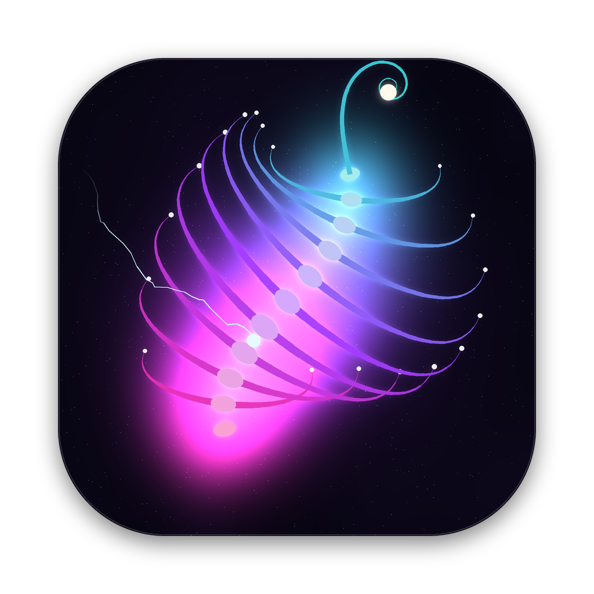

# ZVOID

A modular patch canvas for open-source AI music models. Everything runs locally on your Mac.

Drop modules on the void, drag cables between them, and audio flows down the wires:
generate a track, split it into stems, continue the drums with another model, turn the bass into MIDI.

<p align="center"></p>

## What it does

| Module | Engine | What it's for |
|---|---|---|
| **ace-step** | [ACE-Step 1.5](https://github.com/ace-step/ACE-Step-1.5) | Full tracks from tags and lyrics, up to 10 min. Restyle your own track (*cover*), redo a section (*repaint*), add an instrument (*lego*), arrange around an idea (*complete*). |
| **musicgen** | [MusicGen](https://huggingface.co/facebook/musicgen-melody) | Text-to-music. *Melody* models follow a tune you give them; other models continue your audio. |
| **stable audio** | [Stable Audio Open](https://huggingface.co/stabilityai/stable-audio-open-1.0) | Loops, drums, one-shots, textures and FX, plus variations of your own audio. |
| **stems** | [Demucs](https://github.com/adefossez/demucs) | Split a track into drums / bass / vocals / other. |
| **audio → midi** | [Basic Pitch](https://github.com/spotify/basic-pitch) | Turn audio into a `.mid` file for your DAW. |
| **sample** | — | Your own audio. Drop files anywhere on the canvas. |

- **Wiring:** drag from an output port to an input port. Running a module runs whatever feeds it first.
- **Every knob:** each module exposes the model's settings, an *advanced* section, and a raw JSON box for anything else.
- **✦ claude:** a chat panel that builds, tweaks and runs patches for you, through your own [Claude Code](https://claude.com/claude-code) CLI.
- **Library:** every run is saved with its exact settings and seed.
- **Patches:** save and reload your wiring.

## Requirements

- An Apple Silicon Mac (it uses the Apple GPU through PyTorch MPS). 32 GB+ of memory recommended.
- [uv](https://docs.astral.sh/uv/) (`brew install uv`) and `ffmpeg` (`brew install ffmpeg`).
- About 25 GB of free disk for all model weights.
- Optional: the Claude Code CLI, logged in, for the chat panel.

## Install and run

```bash
git clone https://github.com/vidvidvid/zvoid && cd zvoid
./zvoid install        # creates one Python env per engine (a few minutes)
./zvoid                # opens the app in its own window
```

You can also double-click **Zvoid.app** in this folder and drag it to your Dock.

**No model weights are in this repo.** Each engine downloads its weights from Hugging Face the first time
you use it. ACE-Step goes into `models/`; the others go into the shared `~/.cache/huggingface`.

Stable Audio Open is gated: accept the license on its
[model page](https://huggingface.co/stabilityai/stable-audio-open-1.0), then run `./zvoid login`.

## Using it

| Do this | To |
|---|---|
| Double-click the void, or press `space` | Add a module |
| Drag from a port on the right of a module to a port on the left of another | Wire them |
| Select a cable or module and press `⌫` | Remove it |
| `▸` on a module (shift-click to redo everything upstream) | Run it |
| `⌘↵` | Run the whole patch |
| `⌘K` | Open the Claude chat |
| Scroll / pinch, `F` | Pan / zoom, fit everything |
| Drop audio files on the canvas or on a module | Bring in your own music |

## The gym: raise a creature on your own music

Press **◍ gym**. A creature is a LoRA adapter for ACE-Step, trained on audio you feed it.

1. **Hatch** one by giving it a name.
2. **Feed** it: drop your tracks on the gym screen, press `◍` on any result on the canvas, or use
   **feed a folder** to scan a whole folder and tick the tracks you want (they are linked, not copied).
   10–30 tracks in one style is a good start. Describe its sound in tags, since good captions matter a lot.
3. **Train** it. Training runs on the Apple GPU with ACE-Step's own trainer, saves a checkpoint every
   10 epochs, and can be stopped and continued any time.
4. **Use** it: pick it as *creature* in any ace-step module and set *creature strength*.

The creature on screen is drawn from what it ate and how far it has trained. Each track becomes a tentacle
(colour from the track's brightness, sway from its tempo and dynamics, thickness from its bass). Bass makes the
body lobed, treble makes it spiky, more minutes of audio make it bigger. Training grows the tentacles, adds
organs with every doubling of epochs, and it opens its eyes once it has learned something.

Creatures live in `creatures/<name>/` (food, checkpoints, the final adapter and `creature.json`).
That folder is not committed, so your music and adapters stay on your machine.

## About the Claude chat

The chat shells out to the `claude` CLI on your machine, using your own login. It sends your message,
the settings of the modules on the canvas, and the list of engines. **Audio is never sent.** Everything else in
Zvoid works offline once the models are downloaded. Set `ZVOID_CLAUDE_MODEL` to pick a model.

## Commands

```bash
./zvoid                    # start the app
./zvoid install [engine…]  # install or reinstall engines
./zvoid list               # engines, install status, env size
./zvoid login              # Hugging Face login (for gated models)
./zvoid run --browser      # open in your web browser instead of a window
./zvoid run --headless --port 7861
```

## Where things live

| Folder | What |
|---|---|
| `outputs/` | Everything you generate, one folder per run with a `meta.json` |
| `patches/` | Saved wiring |
| `creatures/` | Gym creatures: the audio you fed them and their trained adapters |
| `engines/<id>/` | One folder per engine: `engine.json` (ports and knobs) and `engine.py` (the code) |
| `.envs/<id>/` | Each engine's own Python environment |
| `src/zvoid/` | The app: a small local server (`server.py`) and the canvas (`web/`) |

## Adding your own engine

1. Create `engines/<id>/engine.json` with `name`, `python`, `requirements`, `outputs` and a `params` list.
   Param types: `text`, `textarea`, `slider`, `int`, `number`, `seed`, `choice`, `bool`, `audio`.
   Every `audio` param becomes an input port. Add `"advanced": true` to tuck a knob away.
2. Create `engines/<id>/engine.py` with `run(params, ctx)`:
   ```python
   from slutil import out, save_audio

   def run(p, ctx):
       ctx.progress("working…")
       path = save_audio(ctx.path("result.wav"), audio, sr)
       return {"outputs": [out(path)], "info": {}}
   ```
3. Run `./zvoid install <id>` and restart. The module appears in the dock, and Claude can use it too.

Engines run in long-lived worker processes, so models stay loaded between runs.

## Licenses

Zvoid's own code is MIT. The models have their own terms, so check before you release music:
MusicGen weights are **non-commercial** (CC-BY-NC 4.0), Stable Audio Open uses the Stability AI Community
License, and ACE-Step, Demucs and Basic Pitch are MIT / Apache 2.0.
